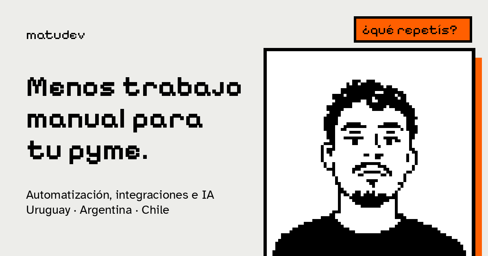

<div align="center">

<a href="https://www.matudev.com/"></a>

<br />

[](https://www.matudev.com/)
[](https://www.linkedin.com/in/lopez-matias/)
[](https://github.com/lopez-matias)
[](https://wa.me/59898445531)

</div>

## Qué es esto

El código de **[matudev.com](https://www.matudev.com/)**, mi sitio como desarrollador freelance. Ayudo a pymes de Uruguay, Argentina y Chile a:

|     | Problema                                                           | Qué hago                                                                           |
| :-: | ------------------------------------------------------------------ | ---------------------------------------------------------------------------------- |
| 🟧  | Horas copiando datos, armando reportes o mandando los mismos mails | **Automatización de procesos** con n8n, Python, Power Automate y Linux             |
| 🟧  | Stock, pedidos y facturación que no coinciden entre sistemas       | **Integración de sistemas**: ERP (Odoo), tienda online, CRM y APIs                 |
| 🟧  | Consultas repetidas, comprobantes que se leen a mano               | **IA aplicada**: asistentes y lectura de documentos, en la nube o local con Ollama |

¿Tenés un proceso que te gustaría automatizar? **[Agendá una llamada de 30 minutos](https://www.matudev.com/#contacto)**. Es sin costo.

## Diseño

```text
█▀▀▀▀▀▀▀▀▀▀▀▀▀▀▀▀▀▀▀▀▀▀▀▀▀▀▀▀▀▀▀▀▀▀▀▀▀▀▀▀▀▀▀▀▀▀▀▀▀█
█  paper #EDEDEA   ink #000000   orange #FF5F00   █
█  títulos: Pixelify Sans · texto: Atkinson       █
█  unidad de pixel: 4px (bordes, sombras, notch)  █
█▄▄▄▄▄▄▄▄▄▄▄▄▄▄▄▄▄▄▄▄▄▄▄▄▄▄▄▄▄▄▄▄▄▄▄▄▄▄▄▄▄▄▄▄▄▄▄▄▄█
```

- Estética pixel-art en blanco, negro y un solo naranja, usado como relleno y nunca como color de texto.
- El retrato es un PNG de 72×72 px escalado con `image-rendering: pixelated`. El mismo archivo se usa para el avatar, el favicon y la imagen para compartir.
- Botones con contorno "dentado" hecho con `box-shadow` y sombras duras sin blur.
- Tema claro y oscuro, versión en español e inglés (`?lang=en`) y `prefers-reduced-motion` respetado.

## Stack

| Área       | Tecnología                                                        |
| ---------- | ----------------------------------------------------------------- |
| Frontend   | HTML, CSS y JavaScript nativos, sin frameworks                    |
| Formulario | Función serverless de Vercel + [Resend](https://resend.com)       |
| Calidad    | ESLint, Prettier, Node test runner, QA visual con Playwright Core |
| Hosting    | Vercel, con deploy automático en cada push a `main`               |

## Correr en local

Requiere Node.js 24, npm y Python 3.

```bash
git clone https://github.com/lopez-matias/personal_landing.git
cd personal_landing
npm ci
npm run dev        # servidor estático en http://localhost:4173
```

> `npm run dev` no ejecuta `api/contact.js`. Para probar el envío real del formulario hace falta un entorno con Vercel Functions y las variables de entorno.

| Comando             | Qué hace                                      |
| ------------------- | --------------------------------------------- |
| `npm run build`     | Valida y genera `public/`                     |
| `npm test`          | Tests de contenido y del endpoint de contacto |
| `npm run lint`      | ESLint + Prettier                             |
| `npm run qa:visual` | Chequeo visual                                |

### Variables de entorno

| Variable             | Uso                              |
| -------------------- | -------------------------------- |
| `RESEND_API_KEY`     | API key privada de Resend        |
| `CONTACT_FROM_EMAIL` | Remitente verificado en Resend   |
| `CONTACT_TO_EMAIL`   | Casilla que recibe las consultas |

Sin `RESEND_API_KEY`, el endpoint responde en modo desarrollo y no envía el correo. Ver `.env.example`.

## Estructura

```text
personal_landing/
├── api/contact.js        # endpoint serverless del formulario
├── assets/
│   ├── css/system.css    # sistema visual pixel-art
│   ├── fonts/            # Pixelify Sans + Atkinson Hyperlegible (OFL)
│   ├── img/              # retrato pixel, capturas de proyectos, íconos
│   └── js/               # i18n, render de proyectos, tema y formulario
├── scripts/              # build, validación y QA visual
├── tests/
├── index.html · privacy.html · gracias.html · 404.html
└── vercel.json           # headers de seguridad y caché
```

## Reutilización

El repo es público para que sirva de referencia. Que sea público no da permiso automático para copiar o redistribuir el código. Si te inspira para tu propio sitio, se agradece un link de vuelta. Las tipografías usan la licencia SIL Open Font License.

<div align="center">
<br />
<sub><b>MATIAS LOPEZ</b> | <a href="https://www.matudev.com/">matudev.com</a> · Montevideo, Uruguay</sub>
</div>
